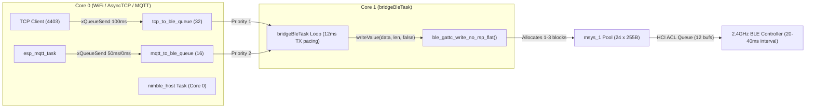

# NimBLE-Arduino 1.4.x to 2.x Upgrade Plan & Technical Research

## 1. Executive Summary

This document captures the research, architectural analysis, implementation plan, and decisions log for upgrading `h2zero/NimBLE-Arduino` from `^1.4.1` (`1.4.3`) to `^2.1.0` (`2.x` release line) across all supported ESP32 targets (`seeed_xiao_esp32s3`, `esp32dev`, `esp32-s3-devkitc-1`).

Beyond migrating to the `2.x` C++ API in `src/ble_client.cpp` and `src/bridge.cpp`, our review of the `1.4.x` vs `2.x` stack internals uncovered **three critical behavioral and timing findings** affecting how packets are queued, read, and written over BLE:

1. **First-Boot MTU Negotiation Order (`255` vs `512` bytes):**
   In `src/bridge.cpp`, `NimBLEDevice::setMTU(512)` was previously called *after* `bleClient->connect(addr, false)`. Because NimBLE (both `1.4.x` and `2.x`) initiates the GATT MTU exchange *inside* `connect()` (`BLE_GAP_EVENT_CONNECT`), the first BLE connection after boot negotiated the default `255`-byte MTU instead of `512` bytes. Any outbound `ToRadio` packet $>252$ bytes silently fell back from non-blocking `ble_gattc_write_no_rsp_flat()` to blocking multi-packet `ble_gattc_write_long()` (Prepare/Execute Write with response). Moving `NimBLEDevice::setMTU(BLE_MTU_SIZE)` prior to `connect()` ensures `512` bytes is negotiated on the very first connection.
2. **Eliminating `NimBLEAttValue` Heap Fragmentation on `FromRadio` Reads:**
   In `2.x` (`2.5.2`), `NimBLERemoteValueAttribute::readValue()` constructs a `NimBLEAttValue` initialized with `CONFIG_NIMBLE_CPP_ATT_VALUE_INIT_LENGTH` (default `20` bytes) and `realloc()`s both the temporary read buffer (inside `onReadCB` on Core 0) and `fromRadioChar->m_value` (`deepCopy()` on Core 1) whenever payload sizes fluctuate between `0` bytes (idle 250ms polls) and $30..512$ bytes (packets). By combining `NimBLEAttValue` + a static `lastPacket[MESHTASTIC_MAX_PACKET_SIZE]` buffer in `pollFromRadio()` with `-D CONFIG_NIMBLE_CPP_ATT_VALUE_INIT_LENGTH=512`, `fromRadioChar->m_value` is allocated once at `512` bytes and never reallocated, and temporary `readValue()` buffers use a constant `512`-byte size with zero `realloc()` churn or heap fragmentation.
3. **Duplex Burst Pacing & `msys_1` Buffer Exhaustion Window:**
   When `pendingRadioRead` is `true`, `waitTicks` in `bridgeBleTask` drops from `10ms` to `0ms`. Likewise, when multiple packets are queued in `tcp_to_ble_queue`, `xQueueReceive` returns immediately (`0ms`) on every loop iteration. In both cases, `bridgeBleTask` could fire `toRadioChar->writeValue(..., false)` every `1ms` (1000 pkt/s). Furthermore, with `MTU = 512` properly negotiated, each large packet ($>255\text{ B}$) consumes **2–3 `msys_1` blocks** (out of the default `12`) instead of 1. To prevent `msys_1` exhaustion (`BLE_HS_ENOMEM`), we enforce an explicit minimum inter-write pacing interval (`BLE_WRITE_PACING_MS = 12`) and increase `CONFIG_BT_NIMBLE_MSYS1_BLOCK_COUNT` from `12` to `24`.

---

## 2. Deep-Dive Research: Side Effects, Timings, Buffering, Locking & Memory

### 2.1 Writing Data to the BLE Radio (`ToRadio`) & Buffer Overruns

* **How `writeValue(..., false)` Works in `2.x`:**
  In `2.x`, `NimBLERemoteCharacteristic` inherits `writeValue()` from `NimBLERemoteValueAttribute`. When `response == false` and `length <= (mtu - 3)`, it calls `ble_gattc_write_no_rsp_flat(connHandle, attrHandle, data, length)` and returns immediately without waiting for the physical BLE connection event.
* **Risk 1: `msys_1` Block Exhaustion on Large Payloads (`>255` Bytes):**
  * NimBLE's internal `msys_1` mbuf pool defaults to `CONFIG_BT_NIMBLE_MSYS1_BLOCK_COUNT = 12` blocks of `255` bytes each (shared across both TX writes and RX notifications/reads).
  * A 500-byte Meshtastic packet (e.g., `NodeInfo` or `MqttClientProxyMessage`) requires **3 `msys_1` blocks** chained together.
  * With only 12 blocks, 4 back-to-back large packets queued inside `ble_gattc_write_no_rsp_flat()` within a single 20–40ms BLE connection interval would consume all 12 `msys_1` blocks, causing the 5th `writeValue()` to fail with `rc = BLE_HS_ENOMEM (6)`.
* **Risk 2: Unpaced Writes When `tcp_to_ble_queue` Has Multiple Packets or `pendingRadioRead == true`:**
  * Previously, the `10ms` pacing delay only occurred when **both** `pendingRadioRead == false` **and** `tcp_to_ble_queue` was empty.
  * If a connected Meshtastic App sent a burst of configuration packets over TCP (`tcp_to_ble_queue` non-empty), `xQueueReceive(tcp_to_ble_queue, ...)` returned in `0 ticks` on each loop iteration, firing `writeValue(..., false)` every `1ms`.
  * Similarly, when the radio was actively sending packets (`pendingRadioRead = true`), `waitTicks` was `0`, so queued MQTT downlink packets in `mqtt_to_ble_queue` were also written at `1ms` intervals instead of `11ms` intervals.
* **Resolution:**
  1. **Explicit Inter-Write Pacing (`BLE_WRITE_PACING_MS = 12`) in `bridgeBleTask`:** Track `lastBleWriteMs` in `bridgeBleTask` and only dequeue/transmit from `tcp_to_ble_queue` or `mqtt_to_ble_queue` once at least `BLE_WRITE_PACING_MS` (`12ms`, ~83 pkt/s max) has elapsed since the previous write. When a write was just performed and `pendingRadioRead` is `false`, sleep for the remaining pacing window so the task yields cleanly without busy-looping. This allows `FromRadio` reads to run at full speed (`0ms` wait when `pendingRadioRead == true`) while guaranteeing outbound writes never overrun NimBLE or the radio.
  2. **Increase `CONFIG_BT_NIMBLE_MSYS1_BLOCK_COUNT` from `12` to `24` in `platformio.ini`:** Adds 12 extra 255-byte blocks (~3 KB static RAM), doubling NimBLE's internal buffer headroom for 512-byte MTU packets during duplex WiFi + BLE bursts.
  3. **Check `canWriteNoResponse() || canWrite()`:** Update the write guard on `toRadioChar` to check `(toRadioChar->canWriteNoResponse() || toRadioChar->canWrite())` so radios advertising either `WRITE_NO_RSP` or `WRITE` on `ToRadio` are supported.

---

### 2.2 Reading Data from the BLE Radio (`FromRadio` & `FromNum`)

* **How `readValue()` Works in `2.5.2`:**
  * In `2.5.2`, `NimBLERemoteValueAttribute::readValue()` issues `ble_gattc_read_long()` (`ATT_READ_BLOB_REQ` at offset 0) and automatically falls back to `ble_gattc_read()` (`ATT_READ_REQ`) if the peripheral returns `BLE_ATT_ERR_ATTR_NOT_LONG`.
  * Because we negotiate `MTU = 512` prior to `connect()` (and Meshtastic `FromRadio` packets are $\le 512$ bytes, the Bluetooth Core Spec `BLE_ATT_ATTR_MAX_LEN` ceiling), every `fromRadioChar->readValue()` completes in a single connection event.
* **Can Reads Overrun `ble_to_tcp_queue`?**
  * Each `readValue()` blocks `bridgeBleTask` for 1 BLE connection interval (15–30ms, i.e., ~33–66 packets/sec max).
  * `bridgeNetTask` on Core 0 drains `ble_to_tcp_queue` (`BRIDGE_QUEUE_SIZE = 32`) into LwIP TCP buffers in $<1\text{ms}$ per packet, and `xQueueSend(ble_to_tcp_queue, ..., pdMS_TO_TICKS(50))` provides backpressure if WiFi momentarily stalls.
* **Eliminating `std::string` Copies & `NimBLEAttValue` `realloc()` Churn (`CONFIG_NIMBLE_CPP_ATT_VALUE_INIT_LENGTH = 512`):**
  * Previously, `std::string currentVal = fromRadioChar->readValue();` and `static std::string lastPacket` triggered dynamic heap `std::string` allocations on Core 1 for every read.
  * Using `NimBLEAttValue currentVal = fromRadioChar->readValue();` directly with a static fixed buffer (`static uint8_t lastPacket[MESHTASTIC_MAX_PACKET_SIZE]; static size_t lastPacketLen = 0;`) inside `pollFromRadio()` eliminates `std::string` heap allocations.
  * Additionally, in `NimBLE 2.5.2`, `NimBLEAttValue` defaults its initial buffer capacity (`CONFIG_NIMBLE_CPP_ATT_VALUE_INIT_LENGTH`) to `20` bytes. Without overriding that macro, every packet $>20$ bytes caused `onReadCB` (on Core 0) to `realloc()` the temporary buffer up to $N$ bytes, and then `m_value = value` (`deepCopy()`) `realloc()`ed `fromRadioChar->m_value` up to $N$ bytes on packet reads and back down to `21` bytes on idle `0`-byte reads (every 250ms), splitting heap blocks.
  * Setting `-D CONFIG_NIMBLE_CPP_ATT_VALUE_INIT_LENGTH=512` in `platformio.ini` ensures `fromRadioChar->m_value` is allocated once at `512` bytes (`BLE_ATT_ATTR_MAX_LEN`) and never resized, and every temporary `NimBLEAttValue` uses a constant `513`-byte block with zero `realloc()` calls or heap fragmentation.

---

### 2.3 Locking, Deadlocks, Blocking & Cross-Core Concurrency

* **Task Synchronization (`NimBLETaskData` / `NimBLEUtils::taskWait`) — Critical Warning for Future Work:**
  * In `2.x`, `ble_task_data_t` was refactored into `NimBLETaskData` with `NimBLEUtils::taskWait()` and `NimBLEUtils::taskRelease()`. Under the hood, NimBLE's synchronous GATT calls (`connect()`, `secureConnection()`, `getService()`, `getCharacteristic()`, `subscribe()`, `readValue()`) block the calling task (`bridgeBleTask`) using **FreeRTOS Direct-to-Task Notification index 0** (`ulTaskNotifyTake` / `xTaskNotifyGive`) and pass a stack-allocated `NimBLETaskData` pointer to the NimBLE host callback on Core 0.
  * **IMPORTANT:** Application code must **never** call `xTaskNotifyGive(bridgeBleTaskHandle)` (which uses notification index 0) from `notifyFromNum` or queue producers to wake `bridgeBleTask`. If an index-0 notification is sent while `bridgeBleTask` is blocked inside `fromRadioChar->readValue()`, `readValue()` will wake prematurely and return—destroying its stack frame before `onReadCB` fires on `nimble_host` (Core 0) and causing a dangling-pointer stack corruption crash.
* **Passkey Pairing Flow (`onPassKeyEntry` + `injectPassKey`):**
  * In `2.x`, `onPassKeyEntry(NimBLEConnInfo& connInfo)` is invoked on the `nimble_host` task (Core 0) while `bridgeBleTask` or `bleTestTask` (Core 1) is blocked inside `secureConnection()`.
  * Calling `NimBLEDevice::injectPassKey(connInfo, pin)` directly inside `onPassKeyEntry()` immediately invokes `ble_sm_inject_io(connInfo.getConnHandle(), &pkey)` on the host task without blocking or deadlocking.
* **Out-of-Scope Note (WebUI Scan / Test Connection in Normal Mode):**
  * Triggering a BLE scan or connection test from the WebUI while in Normal Operating Mode (`http://<bridge>.local`) can contend with `bridgeBleTask` on Core 1. This pre-existing behavior is intentionally kept out of scope for the `2.x` upgrade and can be addressed separately if desired.

---

### 2.4 Memory & Flash Footprint Impact

* **Disabling Unused BLE Peripheral / Broadcaster Roles:**
  * Because the bridge operates strictly as a **BLE Central** (`NimBLEClient`) and **BLE Observer** (`NimBLEScan`), adding `-D CONFIG_BT_NIMBLE_ROLE_PERIPHERAL_DISABLED=1` and `-D CONFIG_BT_NIMBLE_ROLE_BROADCASTER_DISABLED=1` in `platformio.ini` strips `NimBLEServer`, `NimBLEAdvertising`, `NimBLEService`, and `NimBLECharacteristic`, saving ~21 KB of Flash and internal GATT server state.
* **Compile-Time Memory & Flash Comparison (`1.4.3` vs `2.5.2`):**

| Target Board | `1.4.3` RAM (`.bss` + `.data`) | `2.5.2` RAM (`.bss` + `.data`) | RAM Delta | `1.4.3` Flash | `2.5.2` Flash | Flash Saved |
| :--- | :--- | :--- | :--- | :--- | :--- | :--- |
| **`seeed_xiao_esp32s3`** | `101,264 B` (30.9%) | `101,752 B` (31.1%) | `+488 B` | `1,313,021 B` (41.7%) | `1,277,477 B` (40.6%) | **`-35,544 B` (-34.7 KB)** |
| **`esp32dev`** | `105,204 B` (32.1%) | `105,764 B` (32.3%) | `+560 B` | `1,438,089 B` (45.7%) | `1,430,101 B` (45.5%) | **`-7,988 B` (-7.8 KB)** |
| **`esp32-s3-devkitc-1`** | `101,520 B` (31.0%) | `102,008 B` (31.1%) | `+488 B` | `1,319,805 B` (42.0%) | `1,284,213 B` (40.8%) | **`-35,592 B` (-34.8 KB)** |

  > *Note on Static RAM Delta:* The `+488 B` to `+560 B` increase in static `.bss` RAM reflects the new `576`-byte static `lastPacket[MESHTASTIC_MAX_PACKET_SIZE]` buffer in `pollFromRadio()` (`src/bridge.cpp`), which permanently replaces dynamic heap `std::string` allocations on Core 1.

---

## 3. Implementation Plan & File Checklist

- [x] **Step 1: Branch & Upgrade Plan Documentation**
  - Create `nimble-2x` branch off `integration`.
  - Commit `docs/nimble-2x-upgrade.md` and reference it in `docs/architecture.md`.
- [x] **Step 2: Build Configuration (`platformio.ini` & `include/build_options.h`)**
  - Bump `h2zero/NimBLE-Arduino` to `^2.1.0` (resolves to `2.5.2`).
  - Add `-D CONFIG_BT_NIMBLE_ROLE_PERIPHERAL_DISABLED=1`, `-D CONFIG_BT_NIMBLE_ROLE_BROADCASTER_DISABLED=1`, `-D CONFIG_BT_NIMBLE_MSYS1_BLOCK_COUNT=24`, and `-D CONFIG_NIMBLE_CPP_ATT_VALUE_INIT_LENGTH=512`.
  - Add `BLE_MTU_SIZE` (`512`) and `BLE_WRITE_PACING_MS` (`12`) in `include/build_options.h`.
- [x] **Step 3: BLE Scanner & Connection Tester (`src/ble_client.cpp`)**
  - *Chunk 3A:* Set `NimBLEDevice::setMTU(BLE_MTU_SIZE)` in `ble_client_init()`, replace inline scan completion lambda with `NimBLEScanCallbacks::onScanEnd`, convert `pScan->start()` duration to milliseconds (`BLUETOOTH_SCAN_TIME_SECONDS * 1000`), and update `results.getDevice(i)` to `const NimBLEAdvertisedDevice*`.
  - *Chunk 3B:* Update `BridgeClientCallbacks` to `2.x` signatures (`onPassKeyEntry` + `NimBLEDevice::injectPassKey`, `onConfirmPasskey` + `NimBLEDevice::injectConfirmPasskey`, `onAuthenticationComplete(NimBLEConnInfo&)`) and convert `pClient->setConnectTimeout()` to milliseconds (`BLUETOOTH_TIMEOUT_SECONDS * 1000`).
- [x] **Step 4: Core BLE Bridge Task (`src/bridge.cpp`)**
  - *Chunk 4A:* Update `BridgeRuntimeClientCallbacks` (`onPassKeyEntry`, `onConfirmPasskey`, `onAuthenticationComplete`, `onDisconnect(NimBLEClient*, int reason)`), move `NimBLEDevice::setMTU(BLE_MTU_SIZE)` before `bleClient->connect()`, and convert `bleClient->setConnectTimeout()` to milliseconds.
  - *Chunk 4B:* Add `BLE_WRITE_PACING_MS` (`12ms`) inter-write pacing guard, check `canWriteNoResponse() || canWrite()`, and refactor `FromRadio` reads into `pollFromRadio()` using `NimBLEAttValue` + a static byte buffer (`lastPacket[MESHTASTIC_MAX_PACKET_SIZE]`) with flat early-return guards and zero heap allocation.
- [x] **Step 5: Multi-Board Build Verification & Documentation Sync**
  - Run `pio run` across `seeed_xiao_esp32s3`, `esp32dev`, and `esp32-s3-devkitc-1` and record before/after Flash and RAM metrics.
  - Update `docs/bridge_architecture.md` and `docs/feature-mqtt-proxy.md` in lockstep.

---

## 4. Decisions, Findings & Issues Log

| Date | Item | Decision / Resolution |
| :--- | :--- | :--- |
| 2026-11-13 | Base Branch Selection | Branched `nimble-2x` off `integration` so both `mqtt-backpressure` and `toolTip` (SPDX headers) are present as the baseline. |
| 2026-11-13 | `msys_1` Pool & Write Pacing | Decided to both increase `CONFIG_BT_NIMBLE_MSYS1_BLOCK_COUNT` from `12` to `24` (~3 KB RAM) and enforce a minimum `12ms` inter-write interval (`BLE_WRITE_PACING_MS`) in `bridgeBleTask` so `FromRadio` burst reads (`pendingRadioRead = true`) and multi-packet TCP bursts cannot overrun NimBLE's `msys_1` buffers when sending 512B MTU packets. |
| 2026-11-13 | Unused NimBLE Roles | Enabled `CONFIG_BT_NIMBLE_ROLE_PERIPHERAL_DISABLED=1` and `CONFIG_BT_NIMBLE_ROLE_BROADCASTER_DISABLED=1` since the bridge only acts as a BLE Central/Observer. |
| 2026-11-13 | Zero-Heap `FromRadio` Read Path & `pollFromRadio()` | Replaced `std::string` conversions on `fromRadioChar->readValue()` with `NimBLEAttValue` and a static byte buffer (`lastPacket[MESHTASTIC_MAX_PACKET_SIZE]`) inside a dedicated `static bool pollFromRadio()` helper using flat early-return guards. Also guarded against oversized payloads (`> MESHTASTIC_MAX_PACKET_SIZE`) before setting `pendingRadioRead = true` to prevent fast-poll spin loops. |
| 2026-11-13 | Fixed `NimBLEAttValue` Capacity (`512` B) | Added `-D CONFIG_NIMBLE_CPP_ATT_VALUE_INIT_LENGTH=512` in `platformio.ini` after code review of `NimBLEAttValue.cpp` revealed its default `20`-byte initial capacity caused `realloc()` fragmentation between `21` bytes (on empty 250ms polls) and $N$ bytes (on packet reads). |
| 2026-11-13 | WebUI Scan/Test Contention in Normal Mode | Kept out of scope for the `2.x` upgrade to keep changes focused. |
